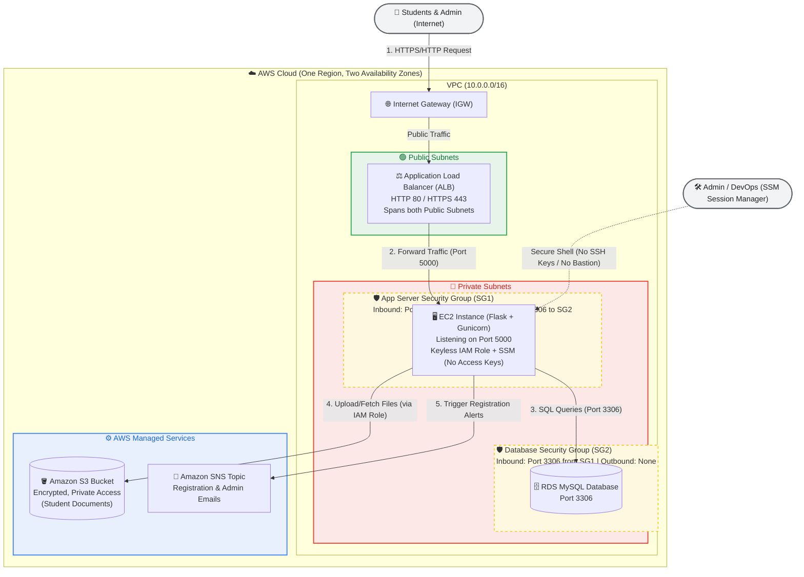

# student_management
A secure, multi-tier AWS student portal built with Flask and Gunicorn. The application runs on EC2 private subnets behind an Application Load Balancer, with MySQL on RDS, private S3 document storage, and SNS registration notifications.

## Features

- Student and administrator authentication
- Student profile and document management
- Private file uploads to Amazon S3
- Registration notifications through Amazon SNS
- Keyless EC2 administration through AWS Systems Manager Session Manager

## 🏗️ AWS Network & Security Architecture

<div align="center">
  
</div>

This multi-tier AWS architecture ensures high availability, strict network isolation, and zero-trust security for the application.

## Architecture Diagram



## 📋 Architectural Breakdown

* **Public Subnet:** Houses the Application Load Balancer, receiving incoming traffic and routing it securely into the private network.
* **Private Subnets:** Contain your EC2 instances running the Flask application and the RDS database, completely isolated from direct public access.
* **Secure Management:** Access to the EC2 instances is managed strictly via AWS Systems Manager, eliminating the need for SSH keys or bastion hosts.
* **Storage and Notifications:** Student files are stored privately in an S3 bucket using IAM roles, while Amazon SNS automatically sends confirmation emails upon registration.

## 🔒 Security Highlights

* **Zero-Trust Access:** No bastion hosts or SSH keys are used; access is strictly controlled via IAM policies and Session Manager.
* **Network Isolation:** Database and application servers reside in private subnets, inaccessible from the public internet.
* **Principle of Least Privilege:** Fine-grained IAM roles ensure components only access the specific resources required.
```
