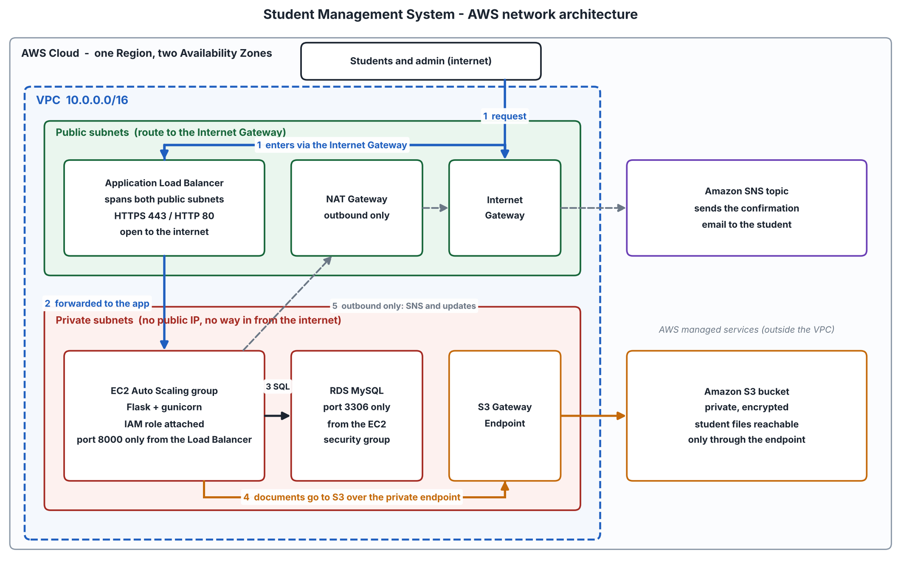
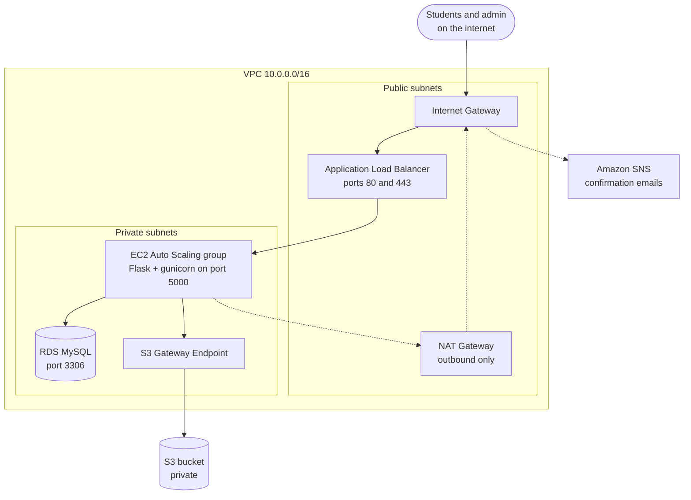

# Student Management System

A Flask app with two roles.

- **Admin**: sees all students, searches them, adds new students, and opens any student's documents.
- **Student**: signs up (or is added by the admin), confirms their email, logs in with their roll number, uploads documents and views their own.

Documents are stored in a **private S3 bucket**. Their details (title, filename, S3 key, size, owner) are stored in **MySQL on RDS**. Sign-up emails are confirmed through **Amazon SNS**.

## Architecture






Who can reach what:

| Resource | Where it lives | Who can reach it |
|---|---|---|
| Load Balancer | Public subnets | The internet, ports 80 and 443 |
| EC2 app servers | Private subnets, no public IP | Only the Load Balancer, port 5000 |
| RDS MySQL | Private subnets, not publicly accessible | Only the EC2 security group, port 3306 |
| S3 bucket | Private bucket, public access blocked | EC2 through the S3 VPC endpoint. Student documents are denied from anywhere else |
| SNS | AWS managed service | EC2 through the NAT Gateway (outbound only) |

S3 and SNS are AWS services, so they sit outside the VPC. The private S3 path is the VPC endpoint. Because browsers are not inside the VPC, the app streams each document to the student itself instead of handing out an S3 link (`PROXY_DOCUMENTS=true`).

## Email confirmation (SNS)

1. The student fills in the sign-up form, including their email.
2. The app subscribes that email to the SNS topic. AWS sends the student an email with a **Confirm subscription** link.
3. The student sees a "Confirm your email" page. They click the link in the email, return, and press **I have confirmed, continue**.
4. The app asks SNS whether the subscription is confirmed. Only then does the login open. Later logins go straight through.

Notes:

- Students added by the admin are treated as confirmed. Only self sign-ups need the email step.
- A student who tries to log in before confirming is sent back to the same page. They can press **Send the email again**.
- The confirmation mail comes from AWS (not from you), so it may land in spam. SNS drops a subscription that is not confirmed within 48 hours, and "Send the email again" creates a fresh one.
- Every student is subscribed to one topic. The app never publishes to it. If you ever publish to it, every student will receive that message.
- To turn the email step off, set `REQUIRE_EMAIL_CONFIRMATION=false`.

## Deploy on AWS

`infra/student-stack.yaml` creates the whole thing: the VPC with two public and two private subnets, Internet Gateway, NAT Gateway, S3 VPC endpoint, security groups, the Load Balancer, the Auto Scaling group of EC2 servers, an encrypted RDS MySQL database, the private S3 bucket, the SNS topic, and the IAM role. The database password is generated by AWS and kept in Secrets Manager, so it is never written in the template.

1. Create the stack (AWS CLI shown; the CloudFormation console works too):

   ```bash
   aws cloudformation deploy --template-file infra/student-stack.yaml \
     --stack-name student-mgmt --capabilities CAPABILITY_IAM
   aws cloudformation describe-stacks --stack-name student-mgmt --query "Stacks[0].Outputs"
   ```

2. Upload this project's zip to the bucket. The exact command is in the stack output `UploadCommand`:

   ```bash
   aws s3 cp student_management_system.zip s3://<bucket-from-output>/release/student_management_system.zip
   ```

   The servers start before the zip exists and wait for it. Once it is there they install the app, write `.env`, create the tables and start it. Allow 5 to 10 minutes, then open the `AppUrl` output.

3. Create the admin login. The servers have no SSH and no public IP, so use **Systems Manager > Session Manager** in the console, pick an instance, and run:

   ```bash
   cd /opt/student_app/student_management_system
   sudo -u ec2-user venv/bin/flask --app app create-admin
   ```

4. For HTTPS, request a certificate in ACM and update the stack with the `CertificateArn` parameter. HTTP then redirects to HTTPS.

Other things to know:

- Student documents can be reached only through the app. The bucket denies them from anywhere else, including the AWS console.
- `InstanceCount` defaults to 1. Set 2 or more to spread servers over both zones. The NAT Gateway is in one zone only.
- The NAT Gateway, Load Balancer and RDS are billed by the hour. To remove everything run `aws cloudformation delete-stack --stack-name student-mgmt`. The S3 bucket is kept (it holds student files) and RDS takes a final snapshot. Delete those by hand if you no longer want them.
- The stack template was checked with `cfn-lint` but I could not deploy it to a real account, so expect to fix small things on the first run. Read the instance log with `sudo cat /var/log/cloud-init-output.log` in a Session Manager session.

## Run on your own computer

The stack's bucket only answers from inside the VPC, so for local testing use a separate private bucket (or turn off the pieces that need AWS).

Windows PowerShell:

```powershell
cd student_management_system
python -m venv venv
.\venv\Scripts\Activate.ps1
pip install -r requirements.txt
Copy-Item .env.example .env
```

macOS or Linux:

```bash
cd student_management_system
python3 -m venv venv && source venv/bin/activate
pip install -r requirements.txt
cp .env.example .env
```

Edit `.env`: your MySQL details and test bucket, plus these two so nothing needs the VPC or SNS:

```
PROXY_DOCUMENTS=false
REQUIRE_EMAIL_CONFIRMATION=false
```

Then create the tables and an admin and start the app:

```bash
mysql -h <host> -u <user> -p < database.sql      # or: flask --app app init-db
flask --app app create-admin
python app.py                                      # http://localhost:5000
```

## Project layout

```
app.py             routes, login, sign-up, email confirmation, upload and view
config.py          settings read from .env
models.py          User, Student, Document tables
s3_utils.py        S3 upload, download, delete, signed links
sns_utils.py       SNS subscribe and confirmation check
database.sql       optional: create the schema by hand
infra/             CloudFormation stack for the VPC, load balancer, servers, RDS, S3, SNS, IAM
deploy/            server bootstrap script and systemd unit used by the stack
docs/              architecture diagram
templates/ static/
```

## Notes

- Allowed uploads: PDF, PNG, JPG, JPEG, DOC, DOCX, up to 10 MB. Files are served with a fixed content type based on the extension, never one the browser claimed.
- Forms are CSRF-protected and passwords are stored hashed.
- Set `ALLOW_SELF_REGISTRATION=false` to stop public sign-up so only the admin can add students. Admin accounts are only created with `flask --app app create-admin`.
